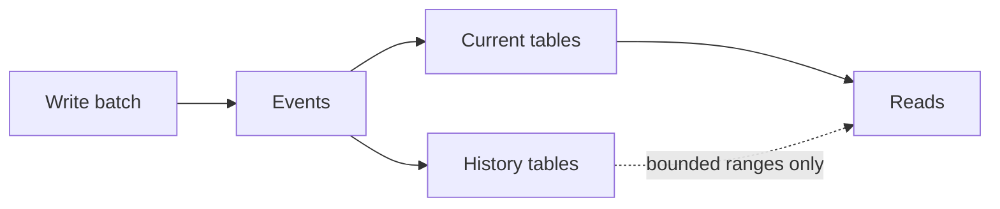
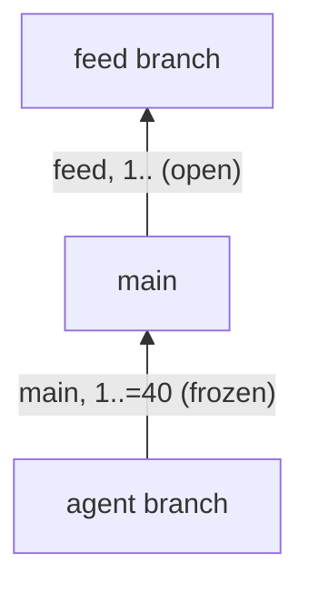
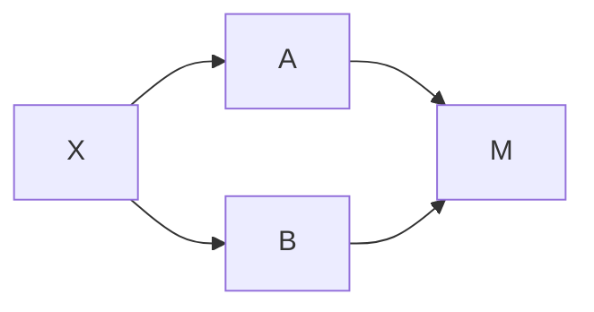
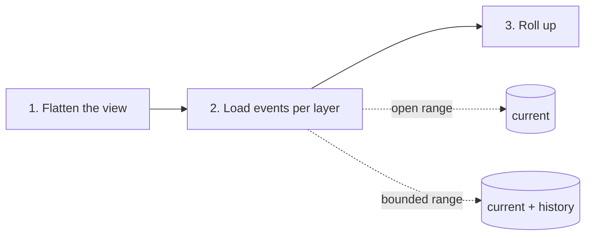
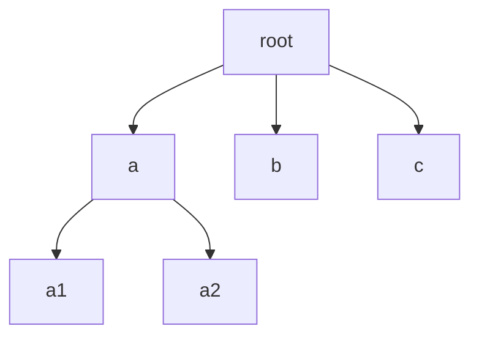

# egdb architecture

This document gives the principles of the store and the reasons for them.
It does not give the implementation. For tables, types and functions, see `DESIGN.md` and the code.
The text uses ASD-STE100 Simplified Technical English.

## 1. Purpose

egdb keeps a graph of entities as a list of events.
Agents and people write to the graph.
Agents work in branches, so that their errors do not damage the main data.
The store must be fast, simple to set up, and safe for many small writes.

## 2. Events are the source of truth

- The store records each change as an event. It does not change data in place.
- Why: events give a full record. Branches, undo and sync all need that record.
- There are only two kinds of event:
  - A **value event** sets one key of one entity.
  - A **link event** sets the state of one link between two entities.
- Why only two: a small model is easy to merge, to sync and to explain.
- One write call is one batch. A batch is one transaction. All of its events are written, or none.

## 3. Entities

- **An entity exists when it has events.** There is no "create" event and no "delete" event.
  - Why: a create event adds an order problem. Two branches could create one entity. Without create events, there is nothing to conflict.
- **Null clears a value.** There is no "clear" event.
  - Why: one rule for all values. A clear is just a value.
- **Archive = set the type to null.**
  - The `type` value names the kind of entity. An archived entity has a null type.
  - To restore an entity, the caller gives the type again. The store does not search history for the old type.
  - Why: archiving is then a normal value event. It merges and undoes like all other events.
- **Implicit filter: reads of links show only entities with a type.**
  - An entity whose type is null, or that never had a type, is hidden.
  - Why: archived entities must disappear from normal views without a delete. One rule also covers half-written entities.
  - A separate read skips the filter, for repair tools.

## 4. Links

- A link joins a source and a destination with a link type. It carries no other data.
  - Why: data on links makes merges hard. If a link needs data, use an entity.
- Each link has one sort key, a number that can be null.
  - The default key is the timestamp of the event that added the link. New links thus go to the end.
  - A caller can give an explicit number. This puts the link at a chosen place.
  - Null means "removed".
  - Why: one number gives the order, and the "removed" state, in one field. It is the same pattern as "null clears a value".
- A read of links takes the last event for each link, drops removed links, groups them, and sorts them by the key.

## 5. Sequence IDs

- Each branch numbers its own events: 1, 2, 3 and so on.
- The pair (branch, sequence ID) identifies an event everywhere.
- Why: a per-branch counter needs no global lock and no clock. Sequence IDs order events even when clocks are wrong.
- Sequence IDs are never used again, also after an undo.
  - Why: a sync peer must never see two events with one ID.
- Timestamps do not order events. They only give the default sort key of links.

## 6. Branches

### 6.1 Branches are agent sandboxes

- An agent works in its own branch. It can make errors freely.
- After the work, a person does one of these:
  - Merge the branch.
  - Undo some of its work.
  - Do not merge it.
- Branches are archived, never deleted.
  - Why: the record stays complete. An archived branch can be read and restored.
- A branch ID is fixed when the branch is made.
  - Why: a later sync between stores must match branches by ID.

### 6.2 Parent lists and ranges

- A branch has a list of parents. Each entry is a branch and a range of its sequence IDs.
- A range with an upper bound is **frozen**. It never shows new events of that parent.
- A range with no upper bound is **open**. It follows the parent live.
- A branch can take events from any number of other branches.
- Why ranges: a range is a small record. It shows events of another branch without a copy of them.

### 6.3 Fork, merge, rebase

- **Fork** makes a new branch that sees what its source sees now, frozen.
  - Why frozen: after a fork, the agent must not see new events of the parent. Its work must not change under it.
- **Merge** puts the other branch's work on top of what the target has now.
  - There is no conflict resolution. The data is conflict-free. A stack of layers always gives a valid result.
  - Why: the layer order decides each value. Nothing can be in conflict, so there is nothing to resolve.
  - The merge does not add the other branch's old copy of the target. That copy would hide the target's own later edits.
- **Rebase** changes the parent list. It does not rewrite events.
- **Do not copy events** unless there is a very good reason.
  - Why: copies make two versions of one fact. Ranges show the same events with no copy.
- Fork and merge freeze ranges at the current heads. They record numbers only.

## 7. Flattening the parent graph

Each read first turns the parent graph into one flat list of branches.

The expansion of X is `M, A, M, B, X`. After dedupe, the list is `M, A, B, X`.

The rules:

1. **Expand depth-first, in parent-list order.** For each entry, put the entry's own parents first, then the entry.
   - Thus a branch always comes after its parents.
   - Only open entries expand. A frozen entry gives only that branch's own events.
   - Why: frozen means frozen. A later change to the parent's parents must not appear.
2. **Dedupe by branch.** Each branch stays once, at the place where it **first** appears.
   - Why: a shared base (M above) must stay below every branch that builds on it.
   - Alexander accepted this effect: a branch that is reached low and high stays low.
3. **Take the greatest range.** The branch's range runs from its lowest start to its highest end. An open end beats a frozen end.
   - Why: the dedupe must not lose events that some path shows.
   - Alexander accepted this effect: the range also covers the gaps between appearances.
4. **Cycles are cut.** If the expansion meets a branch that it is already expanding, it stops there.
   - Why: two branches can follow each other live. This is a valid use, not an error.
5. **The branch's own events are last.**

## 8. Layered priority

- The flat list is a stack of layers. The first layer has the lowest priority.
- For each value or link, the winning event has the highest layer. In one layer, the highest sequence ID wins.
- The branch's own events are the top layer. They always win.
- Why: the order is clear and has no dependency on clocks. A later layer is a deliberate choice to override an earlier one.

## 9. Current and history tables

- Each kind of event has a **current** table and a **history** table.
- The current table holds the newest event for each target on each branch. When a new event replaces it, the old row moves to history, in the same transaction.
- Why: normal reads touch only small current tables. History stays complete and can be searched.
- History tables have the same lookups as the current tables, with the sequence ID added.
  - Why: a read of an old range must be as direct as a read of the head.

## 10. One read path

- Every read can roll up old events. Most reads point at the current table only, so they roll up few events.
- A read that is not at the head of a branch (a frozen range) also loads history. It uses the same roll-up.
- Why: one logic for all reads. There is no special case for frozen ranges. The source of the events is the only difference.
- The flat view of each branch is kept in memory until a parent list changes.

## 11. Batch reads

- Every low-level read takes a batch of entity IDs and gives the results by ID.
- The store resolves the view once for the call. It sends all IDs in one query for each layer.
- Why: callers often need many entities, for example to show a list. One query for each entity is slow.

## 12. Walk

The walk reads `root, a, a1, a2, b, c`, one node at a time.

- **Depth-first, in link order.** Why: this is the reading order of an outline. It is the same order as the old TypeScript walk.
- **The entity type decides which links to follow.** Why: a list and a task have different children. One map gives each kind its own links.
- **Two questions for each node: "continue?" and "include?".** Why: "continue" stops the walk below a node (depth limits, closed nodes). "Include" only filters the output. A filter must not change where the walk goes.
- **A step limit, and the path of the next node.** Why: a page has a fixed cost. The walk keeps no state between pages. The returned path is all that is necessary to go on from the same place.
- **Every visited node is a step, also when it is not emitted.** Why: a narrow filter on a big tree must return quickly, with few rows and a path to go on.
- **A row is a path and its node.** Why: one entity can be reached by many paths. The path is the identity of the row.
- **No cycles.** A node that is already on the current path is skipped. Why: an entity cannot be its own ancestor. Without this rule, a walk could go on forever.
- **Optional visited set.** It skips an entity that the walk already visited on any path. Why: in a graph with many links, the same subtree would be read many times. The set goes back to the caller with the next path, so pages stay stateless.
- **Read-ahead in batches.** On a miss, the walk loads the needed entities and about two layers below them, in batches. Why: fewer round trips to the database. The read-ahead is limited by the steps left, so a small page does not load the whole graph.
- **Optional cache in the result.** Why: a frontend can show the rows without a second read of the same data.

## 13. Undo

- Undo removes the newest batch of one user on one branch. The batch must be less than five minutes old.
- Undo really removes the events. It then puts back the rows that they replaced, from history to current.
  - Why: reads must never need history to find the current state. Compensating events would leave old state in the current tables.
- Undo refuses when:
  - A later event replaced one of the batch's events. Why: a partial undo is hard to explain.
  - Another branch froze a range over the batch. Why: that branch must keep what it saw.
- Events older than five minutes can never be removed.
  - Why: the window keeps undo for quick corrections. Old events stay part of the permanent record.

## 14. Storage

- The store is one SQLite file, embedded in the program.
- Why: no server, simple setup, full transactions, and good indexes for many small reads and writes.

## 15. Out of scope and pending

- Diffs between branches are out of scope for now.
- `find` is pending. Alexander will give its signature.
- Sync between two stores is not built. Fixed branch IDs and per-branch sequence IDs prepare for it.
